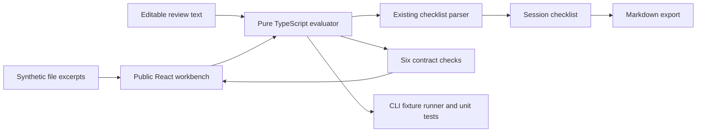

# Review workbench: evidence before confidence

## Problem and implemented flow

The existing application starts with GitHub OAuth and requires configured external services. A visitor assessing the project needs an inspectable path without account setup or paid model calls. `/demo` supplies that path: expand a synthetic code snapshot, choose a review perspective, edit an authored review, run deterministic checks, complete tasks and export Markdown.

The examples are authored fixtures. There are no model latency, token usage, accuracy or customer impact claims associated with them.

## Architecture



`lib/evaluateReview.ts` contains the shared evaluation and export functions. `lib/reviewFixtures.ts` contains the five synthetic excerpts, three authored valid reviews and one deliberately invalid review. `components/ReviewWorkbench.tsx` owns UI state; the public App Router page provides metadata. Existing authenticated routes and the model endpoint remain separate.

## Checks and tradeoffs

The evaluator checks five numbered recommendations, numbering from 1 to 5, distinct normalised titles, nonempty details, a backtick file citation per item, and existence of detected file paths in the provided snapshot. A citation may include a line number, but the evaluator does not verify line ranges. It detects extra entries before the existing parser's five-item cap.

This is a constrained text contract, not a general Markdown parser or model judge. File-like inline code is treated as a citation and compared exactly with the snapshot path list. Semantic advice, vulnerabilities, priority and correctness still require review. Titles with different wording can describe the same problem and pass the duplicate check.

Client-side checks are sufficient for this public fixture workbench: it has no writes, secrets or paid actions. They would not enforce production policy. The existing analysis endpoint does not use these checks. Any future enforcement belongs on the server and needs tests over real model responses.

Review text is capped at 12,000 characters, rendered as React text and never uploaded by this route. Checklist state is intentionally session-only. Editing or changing perspective clears stale evaluation and completion state. Markdown exports include provenance and limitations. No dependencies or database migrations were added.

## Run and validate

Use Node 22 with the existing lockfile:

```sh
npm ci
npm test
npm run eval
npm run build
npm start
# Visit /demo; OAuth is not required for this route.
```

The fixture runner exits nonzero on a changed expectation. Its three valid reviews and one invalid review test the output contract; four fixture expectations do not measure model quality. `.github/workflows/evaluation.yml` runs unit tests and fixtures with Node 22. A local workflow file does not establish that hosted CI has run.

The current build uses existing local environment configuration; a clean build with no service configuration has not been certified. Authenticated GitHub, Anthropic and Supabase flows remain outside this validation scope.

## Case study talking points

- Reused the production checklist parser so the demo tests the same interpretation boundary.
- Separated structural evidence from semantic judgement instead of presenting an unexplained AI quality score.
- Added failing examples to make evaluator limits observable.
- Kept the recruiter path public without granting access to account data or invoking the paid model endpoint.
- Documented deferred work: a real-response dataset, semantic review, server-side policy and live-path security testing.
